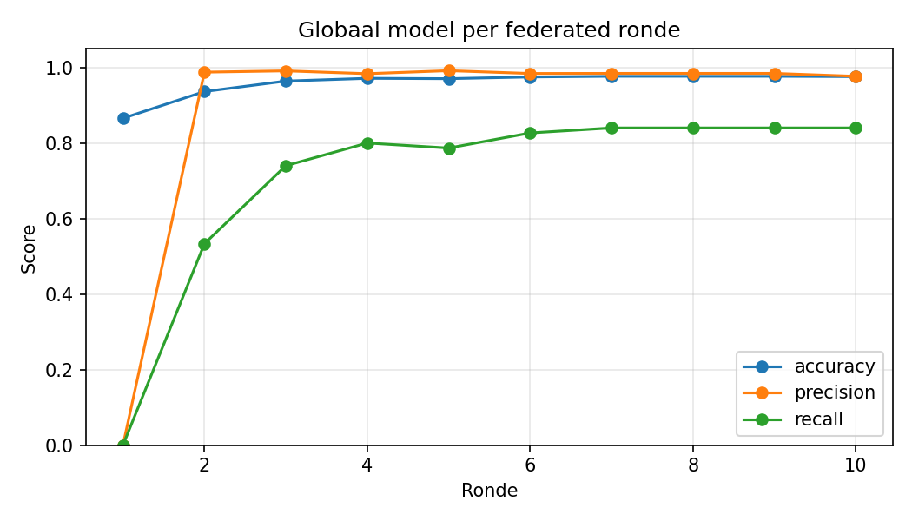
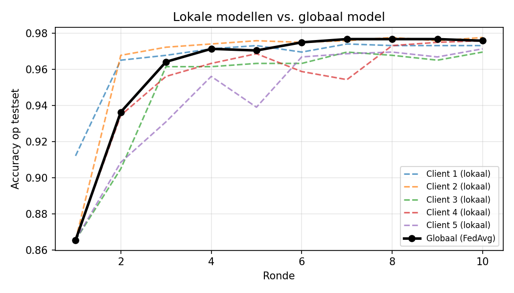
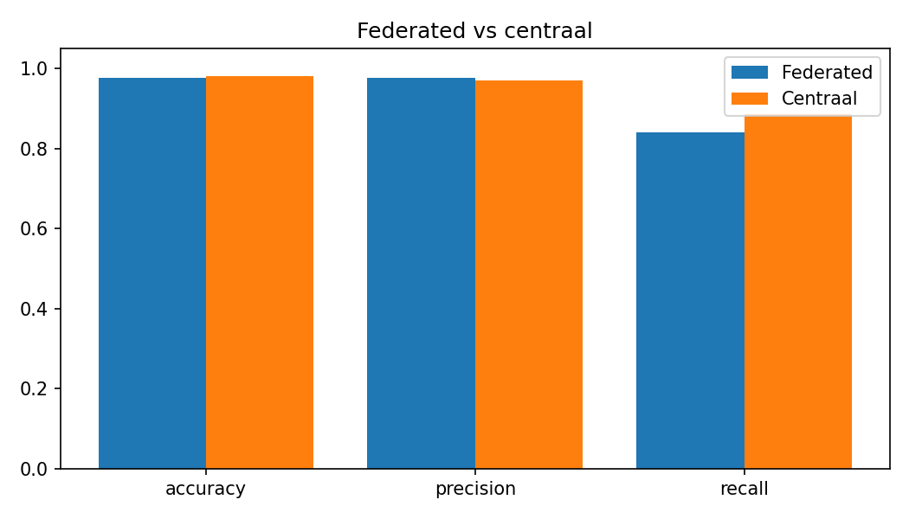

# Labo 7 – Federated Learning: spamdetectie

## 1. Wat heb ik gedaan?

Ik heb de berichten ongelijk verdeeld over 5 clients, elk met een ander aantal spamberichten. Client 1 heeft ongeveer 39% spam, terwijl client 5 maar 3% heeft. Vervolgens traint een logistic regression model elke ronde op de berichten van de clients, het geeft dan op basis van de gewichten een gemiddelde (*Federated Average*), dit gaat dan 10 rondes zo door. Op het einde wordt er getest op de testset en vergeleken met een model dat niet federated learning deed, maar centraal getraind is.

## 2. Reflectie

### Voordelen van federated learning

Federated learning had een recall van 0.840

Centraal getraind had een recall van 0.887

Beide behalen een hoge recall met lichtjes verbetering voor een centraal getraind model, maar dat verschil is klein. Er is daarom bijna geen sprake van een trade-off door federated learning te gebruiken. Omdat de waarden niet veel verschillen, zijn de voordelen vooral voor privacy. Met federated learning blijft de ruwe data op het toestel van de client.

### Beperkingen en invloed van heterogeniteit

De data van de clients is verschillend, waardoor het model in de eerste rondes trager leert dan bij een gelijke verdeling. De grootste beperking is de communicatie: elke ronde moeten alle gewichten van elke client naar de server en terug.

### Conclusie

Federated learning laat toe een client lokaal een model te gebruiken zonder behoefte aan hun ruwe data te sturen naar een server of cloud, enkel gewichten. Hierdoor is het meer privacy bewust. Omdat die heterogeniteit zorgt voor kleine verschillen, is het wel lichtjes anders dan centraal trainen. Maar in deze labo is het verschil klein, enkel voor zeer grote modellen of use-cases kan ik zien dat federated learning niet een goede keuze kan zijn.

## 3. Datasplitsing

| Client | Berichten | % spam |
|---|---|---|
| 1 | 671 | 39% |
| 2 | 731 | 23% |
| 3 | 843 | 9% |
| 4 | 1045 | 6% |
| 5 | 1167 | 3% |

## 4. Resultaten per ronde

| Ronde | Accuracy | Precision | Recall |
|---|---|---|---|
| 1 | 0.865 | 0.000 | 0.000 |
| 2 | 0.936 | 0.988 | 0.533 |
| 3 | 0.964 | 0.991 | 0.740 |
| 4 | 0.971 | 0.984 | 0.800 |
| 5 | 0.970 | 0.992 | 0.787 |
| 6 | 0.975 | 0.984 | 0.827 |
| 7 | 0.977 | 0.984 | 0.840 |
| 8 | 0.977 | 0.984 | 0.840 |
| 9 | 0.977 | 0.984 | 0.840 |
| 10 | 0.976 | 0.977 | 0.840 |

### Lokale modellen tegenover het globale model

## 5. Federated versus centraal

| Metriek | Federated | Centraal |
|---|---|---|
| Accuracy | 0.976 | 0.981 |
| Precision | 0.977 | 0.971 |
| Recall | 0.840 | 0.887 |

## 6. Extra onderzoek: neural network in plaats van Logistic Regression

Gemiddeld over 5 seeds:

| Model | Accuracy | Precision | Recall | F1 |
|---|---|---|---|---|
| Federated Logistic Regression | 0.978 | 0.989 | 0.850 | 0.914 |
| Federated NN (1 laag van 32) | 0.975 | 0.964 | 0.852 | 0.905 |
| Federated NN (1 laag van 32, lagere leersnelheid) | 0.976 | 0.970 | 0.851 | 0.906 |
| Federated NN (2 lagen: 64 en 32) | 0.973 | 0.980 | 0.827 | 0.896 |
| Centraal Logistic Regression | 0.985 | 0.987 | 0.905 | 0.944 |
| Centraal NN (32) | 0.985 | 0.982 | 0.908 | 0.943 |

Er is eigenlijk weinig om te winnen, een groter model (neuraal netwerk) was in mijn test niet beter.

## 7. Obstakels en oplossingen

In het begin leerde het model niks bij: accuracy bleef hangen op 0.87 en de recall was 0. De leersnelheid was te klein en de regularisatie te sterk. Na het aanpassen (`C=100`) werkte het wel. Ook kreeg ik veel waarschuwingen over `max_iter`, maar die zijn normaal omdat de clients per ronde maar kort trainen, dus ik heb die gewoon verborgen.
