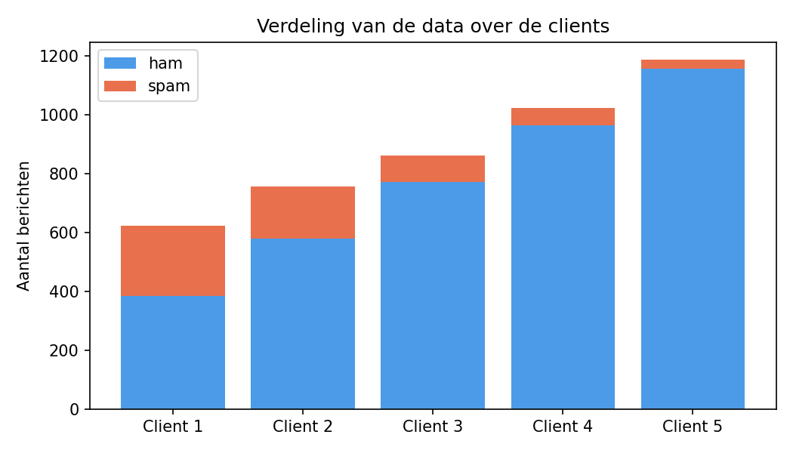
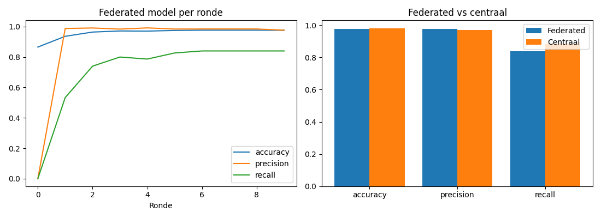
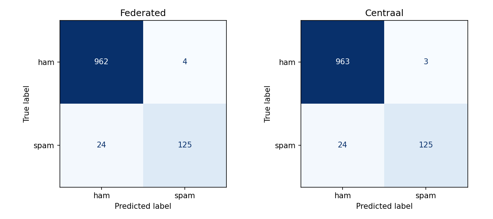

# Labo 7 – Federated Learning: spamdetectie

## 1. Wat heb ik gedaan?

Ik heb de SMS-spamdataset verdeeld over 5 clients, elk met een andere verhouding spam en ham. Elke client traint een Logistic Regression op zijn eigen berichten. Na elke ronde maakt de server het gemiddelde van de gewichten (Federated Averaging) en krijgen de clients dat gemiddelde terug. Dat heb ik 10 rondes herhaald. Op het einde heb ik het model getest op een aparte testset en vergeleken met een model dat op alle data samen getraind is.

## 2. Reflectie

### Voordelen van federated learning

Het resultaat is bijna even goed als centraal trainen (accuracy 0.976 tegenover 0.981). Dus het voordeel ligt niet in de accuracy, maar in de veiligheid. Er is bijna geen sprake van een trade-off door federated learning te gebruiken, dus je profiteert van zowel van de goede resultaten als eigen data governance.

### Beperkingen

Het model heeft meerdere rondes nodig: in ronde 1 is de recall nog 0 en pas rond ronde 7 zit het op 0.84. De recall blijft ook wat lager dan bij het centrale model (0.840 tegenover 0.887). Verder moet er elke ronde veel heen en weer gestuurd worden tussen server en clients, en de resultaten hangen af van variables zoals de leersnelheid.

### Invloed van dataheterogeniteit

Client 1 heeft 39% spam en client 5 maar 3%, dus elk lokaal model leert vooral zijn eigen soort berichten. Het gemiddelde werkt toch goed, maar in een eerdere versie met een hogere leersnelheid sprong de recall van ronde tot ronde heen en weer. Dat komt waarschijnlijk doordat de clients met bijna alleen ham het gemiddelde naar "alles is ham" trekken.

### Conclusie

Federated learning werkt goed voor spamdetectie en je houdt de data privé. Het kost wel iets: meer rondes, meer communicatie en een iets lagere recall. Een neural network gaf geen verbetering ten opzichte van Logistic Regression.

## 3. Datasplitsing (dataheterogeniteit)

| Client | Berichten | % spam |
|---|---|---|
| 1 | 671 | 39% |
| 2 | 731 | 23% |
| 3 | 843 | 9% |
| 4 | 1045 | 6% |
| 5 | 1167 | 3% |

## 4. Resultaten per ronde (globaal model)

| Ronde | Accuracy | Precision | Recall |
|---|---|---|---|
| 1 | 0.865 | 0.000 | 0.000 |
| 2 | 0.936 | 0.988 | 0.533 |
| 3 | 0.964 | 0.991 | 0.740 |
| 4 | 0.971 | 0.984 | 0.800 |
| 5 | 0.970 | 0.992 | 0.787 |
| 6 | 0.975 | 0.984 | 0.827 |
| 7 | 0.977 | 0.984 | 0.840 |
| 8 | 0.977 | 0.984 | 0.840 |
| 9 | 0.977 | 0.984 | 0.840 |
| 10 | 0.976 | 0.977 | 0.840 |

### Lokale modellen tegenover het globale model

## 5. Federated versus centraal

| Metriek | Federated | Centraal |
|---|---|---|
| Accuracy | 0.976 | 0.981 |
| Precision | 0.977 | 0.971 |
| Recall | 0.840 | 0.887 |

## 6. Extra onderzoek: neural network in plaats van Logistic Regression

Gemiddeld over 5 seeds:

| Model | Accuracy | Precision | Recall | F1 |
|---|---|---|---|---|
| Federated Logistic Regression | 0.978 | 0.989 | 0.850 | 0.914 |
| Federated NN (1 laag van 32) | 0.975 | 0.964 | 0.852 | 0.905 |
| Federated NN (1 laag van 32, lagere leersnelheid) | 0.976 | 0.970 | 0.851 | 0.906 |
| Federated NN (2 lagen: 64 en 32) | 0.973 | 0.980 | 0.827 | 0.896 |
| Centraal Logistic Regression | 0.985 | 0.987 | 0.905 | 0.944 |
| Centraal NN (32) | 0.985 | 0.982 | 0.908 | 0.943 |

## 7. Obstakels en oplossingen

In het begin leerde het model niks bij: accuracy bleef hangen op 0.87 en de recall was 0. De leersnelheid was te klein en de regularisatie te sterk. Na het aanpassen (`C=100`) werkte het wel. Ook kreeg ik veel waarschuwingen over `max_iter`, maar die zijn normaal omdat de clients per ronde maar kort trainen, dus ik heb die gewoon verborgen.
